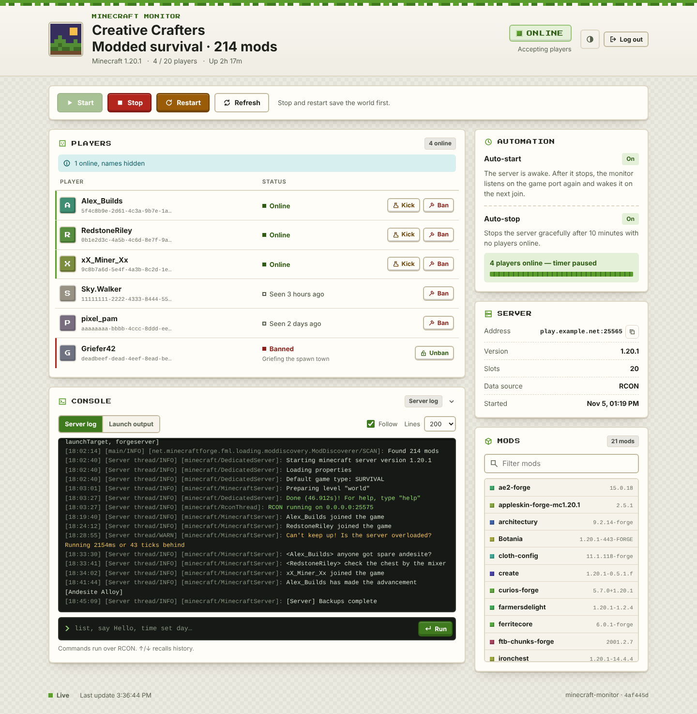

# Minecraft Monitor


A Python application that manages a **modded Minecraft Java server** (Forge,
NeoForge, Fabric, Quilt or vanilla) on Windows and Linux. The server **starts
automatically when a player tries to join** and **shuts down gracefully when it
has been empty for a while**, with a web dashboard to monitor and control it.

It is a Minecraft port of [kevinnio/palworld-monitor](https://github.com/kevinnio/palworld-monitor).



## Features

- **Auto-start ("sleeping server")**: while the server is stopped, the monitor
  listens on the game port itself.
  - The multiplayer list shows a "sleeping" message.
  - A player's join attempt wakes the real server, and the player is told to
    reconnect in a moment.
  - Refreshing the server list never starts it.
  - Players the server would refuse (whitelist, bans) can't wake it.
- **Auto-stop**: once nobody has been online for `stopDelay` seconds (10 minutes
  by default), the server is stopped **gracefully**, so the world is saved.
  - It sends `stop`, waits for the save, and only escalates if the server hangs.
  - It only counts fresh, successful player counts, so a server that is still
    loading or not responding is never shut down by mistake.
- **Web dashboard** (live updates, light/dark, mobile friendly):
  - Start / Stop / Restart, with the state shown as Offline / Starting /
    Loading mods / Online / Stopping.
  - A countdown until auto-stop.
  - Players online and last seen, with kick / ban / unban.
    - Bans also work while the server is asleep (offline edits of
      `banned-players.json`).
  - A server log viewer and an RCON console.
  - The installed mod list, plus version, slots, uptime and address.
- **Modded-friendly**:
  - Long mod-loading times are handled.
  - Forge/NeoForge `run.sh`/`run.bat` wrappers are understood.
  - Already-running servers are adopted (found by their working directory).
  - A first-run wizard detects your launch command and sets up RCON.
- **Security**:
  - Login with lockout.
  - CSRF protection and rate limiting.
  - Passwords are masked in logs.

## How it works

```
 player joins ──► monitor (port 25565, server stopped)
                    │  status ping  → "Server is sleeping - join to wake it up!"
                    │  join attempt → "Starting up, reconnect shortly" + start server
                    ▼
               Minecraft server (port 25565)  ◄── polled every 5 s over RCON
                    │  0 players for stopDelay → "stop" (world saved) → exit
                    ▼
               monitor listens on 25565 again
```

The monitor must run **on the same machine** as the Minecraft server, as the
same user, so it can start, find and stop the server process.

## Quick start

1. Get the app:
   - **Binary:** download `minecraft-monitor-windows.exe` or
     `minecraft-monitor-linux` from the latest
     [GitHub Release](https://github.com/Koilparampil/MinecraftStartStopMonitor/releases).
   - **From source** (Python 3.11+ and [uv](https://docs.astral.sh/uv/)), run
     inside this repository with the absolute path to your server folder:
     ```bash
     uv sync
     uv run poe start --server-dir /path/to/your/server
     ```
2. Run it. The binary can simply be started **from your server folder**, or be
   given `--server-dir`. On first launch, the setup wizard:
   - finds your launch command (`./run.sh nogui` for Forge/NeoForge 1.17+,
     the Fabric/Quilt launcher jar, an old Forge jar, or `server.jar`);
   - offers to enable RCON in `server.properties` (random password,
     `broadcast-rcon-to-ops=false` so polling doesn't spam ops);
   - asks you to accept the [Minecraft EULA](https://aka.ms/MinecraftEULA) if you
     haven't yet;
   - asks you for a dashboard password (the example password `changeme` is
     refused at startup);
   - saves `settings.yaml`, before it touches `server.properties` or
     `eula.txt`.

   Without a terminal (e.g. a service), pass `--server-dir`, `--start-command`
   and `--web-password` (or `--no-web`) once instead. The monitor saves them to
   `settings.yaml` (owner-only permissions) and later runs need no flags.
   `server.properties` and `eula.txt` are left untouched, so enable RCON and
   accept the EULA yourself. Don't keep `--web-password` in a unit file, because
   command lines are visible to every user.
3. Open **http://localhost:25580** and log in (username `admin`). The wizard
   picks another free port if 25580 clashes with your game, RCON or query port.

From then on, just leave the monitor running. Join the server from Minecraft to
wake it up.

## Configuration

The settings file is the first of: `--settings PATH`,
`$MINECRAFT_MONITOR_SETTINGS`, or `settings.yaml` next to the program
(`src/settings.yaml` when running from source). See
[`src/settings.yaml.example`](src/settings.yaml.example) for every option with
comments. Values left `null` are read from the server's own `server.properties`.

The monitor keeps its own files **next to `settings.yaml`**, wherever it is
started from:
- `monitor.log`, rotated at 5 MB with 3 backups;
- `session_secret.key` (signs the dashboard's cookies; deleting it logs everyone out);
- the `data/` folder (`monitor.dataDir`), holding `players.json`, `server.pid`,
  the server's launch output `server-console.log`, `web-sessions.json`
  (hashed "keep me signed in" tokens; deleting it ends remembered logins),
  and `pending-cleanup.json` while background processes of the last launch
  still have to be ended.

Relative paths in the file (`dataDir`, `serverDir`) are resolved against the
settings file's folder.

| Setting (YAML) | CLI flag | Description |
|---|---|---|
| `minecraft.serverDir` ⚑ | `--server-dir PATH` | Server folder (`server.properties`, `mods/`, `world/`) |
| `minecraft.startCommand` ⚑ | `--start-command CMD` | Launch command, run inside the server folder |
| `minecraft.host` | `--host HOST` | Address the monitor uses for RCON/ping (default `127.0.0.1`) |
| `minecraft.port` | `--server-port PORT` | Game port (default: `server-port`, else 25565) |
| `minecraft.rconPort` / `rconPassword` | `--rcon-port` / `--rcon-password` | RCON (default: from `server.properties`) |
| `minecraft.pollingRate` | `--polling-rate SEC` | Seconds between status polls (default 5) |
| `minecraft.stopTimeout` | `--stop-timeout SEC` | Time allowed to save and exit before the server is terminated (default 120) |
| `minecraft.processName` | — | Text identifying the server process (default `java`) |
| `web.enabled` | `--no-web` | Serve the dashboard |
| `web.host` / `web.port` | `--web-port PORT` | Dashboard address (default `0.0.0.0:25580`) |
| `web.username` / `web.password` ⚑ | `--web-username` / `--web-password` | Dashboard login |
| `web.controlServer` | — | Allow start/stop/restart and console commands from the web |
| `web.console` | — | Log viewer + RCON console |
| `web.playerAvatars` | — | Player heads from an external avatar service |
| `web.trustedProxies` | `--trusted-proxies A,B` | Reverse-proxy IPs/CIDRs whose `X-Forwarded-*` headers are trusted (see [Security notes](#security-notes)) |
| `web.secureCookies` | `--secure-cookies` | Mark cookies `Secure` and send HSTS (only behind HTTPS) |
| `features.autoStart` | `--no-auto-start` | Wake the server on a join attempt |
| `features.autoStop` | `--no-auto-stop` | Stop the server when empty |
| `autoStop.stopDelay` | `--auto-stop-delay SEC` | Seconds empty before stopping (default 600) |
| `autoStart.motd` / `kickMessage` / `versionName` | — | What players see while it sleeps / wakes (`§` colour codes work) |
| `autoStart.respectWhitelist` | — | Only players allowed by whitelist/ops/bans can wake the server |

⚑ = required (the setup wizard fills these in). Run with `--help` for all CLI
flags. Misspelled or unknown keys in `settings.yaml` are reported at startup
with a "did you mean" hint.

### RCON

RCON gives the monitor the exact player list and lets the dashboard kick, ban
and run console commands; it is also used to stop an adopted server
gracefully. The wizard enables it for you. To do it by hand, set these in
`server.properties` and restart the server:

```properties
enable-rcon=true
rcon.port=25575
rcon.password=<a long random password>
broadcast-rcon-to-ops=false
```

Without RCON the monitor falls back to the server-list ping. Auto-start and
auto-stop still work, but kick and the console are disabled while the server
runs. Bans can still be changed while it is stopped. If the RCON password is
wrong, the dashboard says so and the monitor retries with a growing delay
instead of filling the server log.

### Modded server tips

- **Use the plain launcher as the start command.** Many modpack `start.sh` /
  `ServerStart.bat` scripts restart the server in a loop, which undoes
  auto-stop. Point `startCommand` at `run.sh`/`run.bat` or the `java -jar …`
  line inside them instead.
- **Forge/NeoForge 1.17+:** memory flags (`-Xmx6G`) go in `user_jvm_args.txt`;
  the start command is `./run.sh nogui` (Linux) or `run.bat nogui` (Windows).
- **Long loading times are fine.** The dashboard shows *Loading* until the
  server answers, and auto-stop doesn't count down until then.
- **Big worlds:** raise `stopTimeout` if saving takes longer than two minutes.
- **Launch scripts that do more than run the server** are fine:
  - Work after the server exits (a backup after `java`, a `| tee` pipeline)
    is never interrupted. A Stop doesn't wait for it, but the next start
    does, for up to `stopTimeout`.
  - Background processes the launch script starts (a tunnel, a backup loop)
    never count as the server. They are ended (SIGTERM, then SIGKILL 10 s
    later) once the server and the launch script have both exited, and at
    the latest right before the next start, which then starts fresh ones.
    This also happens when the monitor was stopped in between.
- **Proxies (Velocity/BungeeCord) and Bedrock/Geyser front-ends** are not
  supported for auto-start: the proxy owns the public port.

### Security notes

- Change the default dashboard password. The RCON console in the dashboard is
  equivalent to the server console (operator commands).
- **Sessions:**
  - Logging out ends the session on the server, so a copied cookie stops
    working.
  - "Keep me signed in" lasts 7 days. Ordinary sessions also end after 12 hours
    regardless of activity.
  - "Log out everywhere" (in the footer) ends every session, and changing the
    dashboard credentials does the same.
  - Restarting the monitor logs out everyone who didn't tick "Keep me signed in".
- **Cross-site protection:** actions only work from the dashboard's own page.
  - Requests from other sites, or from other ports on the same host, are
    refused, in addition to the usual CSRF tokens.
  - Cookies are `SameSite=Strict`, so following a link to the dashboard from
    another site shows the login page until you reload.
- **Connection floods:**
  - The dashboard drops requests that don't arrive within 15 s.
  - It allows at most 24 connections per address and 128 in total, so one
    client can't tie it up.
  - Many users behind one NAT address share the 24.
- **Internet exposure:** put the dashboard behind an HTTPS reverse proxy (nginx,
  Caddy, ...), then:
  - set `web.trustedProxies` to the proxy's address(es), e.g. `["127.0.0.1"]`,
    so the real client address is used for the login lockout, the rate limit
    and the logs. Never list addresses clients connect from directly;
  - make the proxy pass the original host *with its port*, plus the client
    address and scheme. Without this, logins and actions are refused as
    cross-site. In nginx:
    ```nginx
    proxy_http_version 1.1;
    proxy_set_header Host $http_host;   # not $host, which drops the public port
    proxy_set_header X-Forwarded-For $proxy_add_x_forwarded_for;
    proxy_set_header X-Forwarded-Proto $scheme;
    proxy_set_header X-Forwarded-Host "";   # drop what clients send
    proxy_set_header X-Forwarded-Port "";
    ```
    `$http_host` already carries the public port, so don't add
    `X-Forwarded-Port $server_port`: it is wrong when nginx listens on a
    different port than the one players use (Docker port mapping, router
    forwarding). nginx passes client headers through by default, and the
    monitor trusts every `X-Forwarded-*` header that comes from a trusted
    proxy, so the two empty lines stop clients from setting them.
    The live stream disables proxy buffering itself, so no `proxy_buffering`
    change is needed. Serving HTTP/2 at the proxy also lifts browsers' limit of
    6 connections per host;
  - set `web.secureCookies: true` (HTTPS only). Cookies become `Secure` with
    the `__Host-` prefix and HSTS is sent, and plain-HTTP logins stop working.
- The sleeping server can't verify Mojang accounts. Someone who knows a
  whitelisted name could wake the server, but they still can't join it. With
  `respectWhitelist` (default) and a whitelist enabled, random scanners can't
  wake your server.

## Running as a service (Linux)

Run the monitor under systemd so it survives reboots. Create `settings.yaml`
first: run the wizard once in a terminal, or run once with the flags shown in
the quick start. Then:

```bash
sudo cp deploy/minecraft-monitor.service /etc/systemd/system/
sudo nano /etc/systemd/system/minecraft-monitor.service   # edit User / WorkingDirectory / ExecStart
sudo systemctl daemon-reload
sudo systemctl enable --now minecraft-monitor
journalctl -u minecraft-monitor -f
```

- `User` must be the account that owns the Minecraft server files.
- The monitor writes `monitor.log` and `data/` next to its `settings.yaml`.
  `WorkingDirectory` only matters for a relative `--server-dir` on the command
  line.
- The unit uses `KillMode=process`: stopping or restarting the monitor leaves a
  running Minecraft server alone, and the next monitor adopts it. Stop the
  server from the dashboard first if you want it down.
- `TimeoutStopSec` (330 s) must be at least `2 × stopTimeout + 90`. Raise both
  together for big worlds.
- When running from source, `ExecStart` needs the absolute path of `uv`, so
  check it with `command -v uv`.

## Limitations

- Must run on the same host (and as the same user) as the Minecraft server.
- Java Edition only. The sleeping server speaks the 1.7+ protocol (plus the
  legacy ping). It is tested with hand-built handshake/login packets for
  1.7.10 through 1.21.1 and with the `mcstatus` library, not yet with every
  real client build.
- On Windows a server that ignores `stop` is hard-killed after `stopTimeout`
  (there is no graceful signal on Windows); keep `stopTimeout` generous.

## Development

```bash
uv sync               # install deps (Python 3.11+)
uv run poe test       # unit + integration tests
uv run poe smoke      # e2e tests: real app + browser + a dummy Minecraft server
uv run poe lint       # ruff check
uv run poe format     # ruff format
uv run poe build-exe  # standalone binary into dist/
```

The e2e suite is self-contained: it runs the app against a stdlib "dummy"
Minecraft server on free ports and temp folders, and only stops processes it
started, so it is safe to run on a machine with a real server.
`uv run playwright install chromium` once before the first smoke run. See
[`AGENTS.md`](AGENTS.md) for the architecture and
[`docs/ARCHITECTURE.md`](docs/ARCHITECTURE.md) for the design contract. Open
follow-up work from the QA rounds is planned in
[`docs/FOLLOW_UP_PLAN.md`](docs/FOLLOW_UP_PLAN.md).

## License

MIT, see [LICENSE](LICENSE).

## Attribution

Minecraft Monitor is a port of
[palworld-monitor](https://github.com/kevinnio/palworld-monitor) by Kevin Perez,
which is itself based on the original PalWorld Dedicated Server
Auto-Start-Stop script by nomomo. Buy nomomo a coffee:

<a href="https://www.buymeacoffee.com/nomomo" target="_blank"></a>

Minecraft is a trademark of Mojang Studios. This project is not affiliated with
or endorsed by Mojang or Microsoft.
